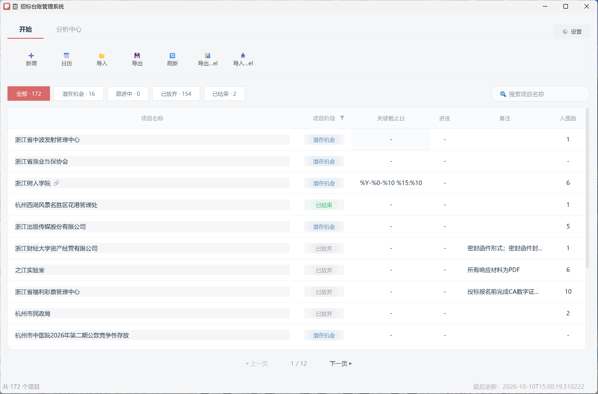

# 招标台账管理系统

一个基于 **PySide6** 的桌面端招标 / 投标台账管理工具，面向招投标业务人员，帮助统一管理项目生命周期、关键截止日、跟进进度，并提供日历视图、投标分析、周报生成与 Excel 数据互通。

> 纯本地单机应用，数据保存在本地 SQLite 数据库，无需联网、无需服务器。

---

## ✨ 功能特性

- **台账总览**：分页表格展示全部项目，支持按「项目阶段」筛选、关键字搜索、列排序。
- **项目维护**：新增 / 编辑 / 查看详情；字段含区域、类别、代理、发布时间、报名截止、投标截止、入围数、进度、结果、放弃原因等。
- **日历视图**：月 / 周双视图，日期格标注当日关键节点：
  - 🔵 蓝 = 报名截止　🔴 红 = 投标截止　🟢 绿 = 发布时间　🟠 橙 = 报名+投标同日
  - 点击日期查看当日项目清单（含进度、区域），点击项目卡片查看完整详情。
- **投标分析**：4 层投标漏斗（潜在机会 → 跟进中 → 已投标 → 已中标）+ 放弃原因饼图 + 分类报表，支持一键导出。
- **周报生成**：按自然周统计，可选 7 个章节（概览 / 漏斗 / 放弃原因 / 进行中清单 / 下周截止提醒 / 区域类别分布 / 自定义备注），生成纯文本周报。
- **数据互通**：支持 Excel 导入 / 导出，便于与既有台账表格对接。
- **系统设置**：维护下拉选项（区域 / 类别 / 代理）；「一键清空数据」带二次确认，清空后界面自动刷新。
- **自动扫描**：启动时自动扫描并标记过期项目，保持台账状态准确。

---

## 🛠 技术栈

| 类别 | 选型 |
| --- | --- |
| 语言 | Python 3.11 |
| GUI | PySide6（Qt 6） |
| 数据存储 | SQLite（零配置、本地文件） |
| 数据处理 | pandas / openpyxl / numpy（Excel 导入导出） |
| 图表 | 自绘 `QPainter`（无matplotlib 依赖） |
| 打包 | PyInstaller（onedir，无控制台窗口） |

---

## 📁 项目结构

```
招标台账管理系统/
├── main.py                  # 程序入口（含 stdout 兜底、应用图标、样式加载）
├── config.py                # 全局配色 COLORS
├── database.py              # SQLite 数据访问层（CRUD / 清空 / 设置读写）
├── requirements.txt         # 运行依赖
├── app_icon.ico             # 应用图标（多尺寸）
├── ui/
│   ├── app.py               # 主窗口（Ribbon / 表格 / 状态栏）
│   ├── dialogs.py           # 设置 / 新增编辑 / 详情 弹窗
│   ├── calendar_widget.py   # 日历视图（月/周 + 四态标记）
│   ├── analysis_dialog.py   # 投标分析（漏斗 + 饼图 + 报表）
│   ├── weekly_report_dialog.py  # 周报生成器
│   ├── styles.py            # 现代风 QSS 样式
│   ├── filter_header.py     # 可筛选表头
│   └── toast.py             # 轻量提示
└── utils/
    ├── constants.py         # 业务常量与字典（阶段 / 状态 / 配色 / DB 路径）
    ├── date_utils.py        # 日期解析 / 排序 / 紧急度
    ├── auto_scan.py         # 启动自动扫描过期项目
    ├── excel_io.py          # Excel 导入导出
    └── data_pack.py         # 数据包工具
```

---

## 🚀 快速开始（源码运行）

> 需要 Windows 环境（PySide6 桌面应用）。建议使用 Python 3.11。

1. 克隆仓库并进入目录：

   ```bash
   git clone <your-repo-url>
   cd 招标台账管理系统
   ```

2. 创建虚拟环境并安装依赖（任选其一）：

   ```bash
   # 使用 venv
   python -m venv venv
   venv\Scripts\activate
   pip install -r requirements.txt
   ```

3. 启动应用：

   ```bash
   python main.py
   ```

首次运行会自动创建 `tender.db` 并写入默认设置。

---

## 📦 打包为桌面应用（Windows）

使用 PyInstaller 构建无控制台的原生 `.exe`：

```bash
pip install pyinstaller
pyinstaller --name TenderManager ^
            --onedir --windowed ^
            --icon app_icon.ico ^
            --add-data "app_icon.ico;." ^
            --hidden-import pandas ^
            --hidden-import openpyxl ^
            --hidden-import numpy ^
            main.py
```

构建完成后，将现有数据文件复制到发布目录即可携带数据分发：

```bash
copy tender.db dist\TenderManager\tender.db
```

随后双击 `dist\TenderManager\TenderManager.exe` 即可运行。

> 💡 **架构说明**：本项目在 **Windows ARM64** 环境下打包（PyInstaller 自带 `Windows-64bit-arm` 引导程序）。若在 x64 机器上打包，请使用对应架构的 Python 与 PyInstaller，命令参数不变。

---

## 💾 数据与持久化

- 数据保存在 **SQLite 文件 `tender.db`**。
- 运行源码时：`tender.db` 位于项目根目录。
- 运行打包后的 exe 时：`tender.db` 位于 `TenderManager.exe` **同目录**，方便随应用整体迁移、数据不丢失。
- `tender.db` 含有你的业务数据，**已加入 `.gitignore`，不会提交到仓库**。

---

## ❓ 常见问题

- **看不到窗口 / 启动报错？** 确认已安装 `requirements.txt` 中的全部依赖，且 Python 版本 ≥ 3.11。
- **图标不显示？** 源码运行需 `app_icon.ico` 在项目根目录；打包后图标随 `--add-data` 一并进入 `_internal/`，由程序自动定位。
- **如何清空全部数据？** 右上角「⚙️ 设置」→「数据管理」→「🗑 一键清空所有数据」，二次确认后执行（保留下拉选项设置，仅清空项目记录）。
- **Excel 导入失败？** 请确认导入文件为 `.xlsx`，且表头与系统字段一致（可先「导出 Excel」作为模板参考）。

---

## 📄 开源协议

本项目以 **MIT License** 开源，详见 [LICENSE](LICENSE) 文件。

---

Made with PySide6 · 让招投标台账管理更轻松。
